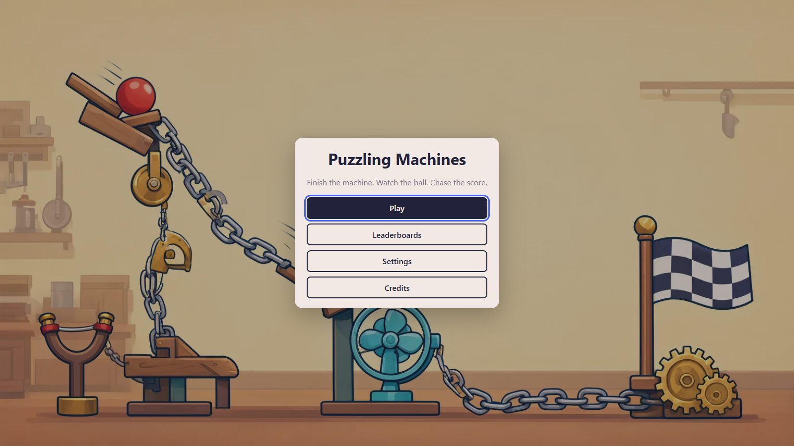
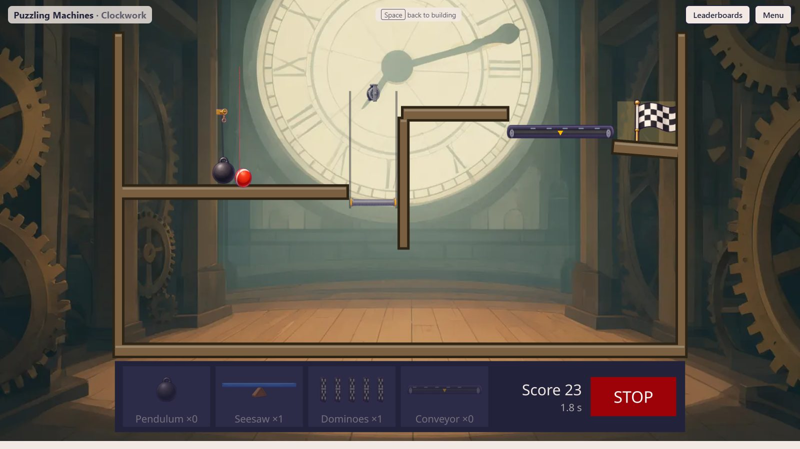
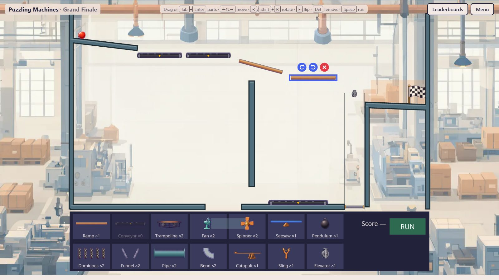

# Puzzling Machines

A 2D physics puzzle game about finishing incomplete Rube Goldberg machines. Built with React Three Fiber and Rapier.

Current status: **Phase 4 (five scenes, art, audio, accessibility)**. The game has five scenes (First Steps, Up the Wall, The Gap, Clockwork and Grand Finale), generated art, and keyboard building. Sound is fully wired and plays as soon as the audio files exist. See [`docs/ROADMAP.md`](docs/ROADMAP.md).







## Getting started

Requires Node 22+.

```sh
npm install
npm run dev        # http://localhost:5173
```

From the menu, play a scene, drag parts from the tray into the shaded build area, then press **RUN** (or `Space`). `R` / `Shift+R` rotate the selected part, `F` flips it, `Del` removes it, `Esc` deselects. `` ` `` toggles the physics debug overlay. Completing a scene unlocks the next. Layouts, progress and leaderboards are saved in the browser.

**Keyboard only:** `Tab` to the board, `Tab` / `Shift+Tab` to pick a tray part, `Enter` to place it, arrow keys to move it (`Shift` for bigger steps), then `R` / `F` / `Del` and `Space` as above.

**Sound:** drop the MP3s listed in [`docs/AUDIO.md`](docs/AUDIO.md) into `public/audio/`; missing files are skipped.

## Scripts

| Command             | What it does                                              |
| ------------------- | --------------------------------------------------------- |
| `npm run dev`       | Vite dev server                                           |
| `npm run build`     | Typecheck and production build                            |
| `npm run analyze`   | Production build plus bundle treemap at `dist/stats.html` |
| `npm test`          | Vitest (headless physics, scene solvability, unit tests)  |
| `npm run e2e`       | Playwright smoke test (builds, serves, plays Scene 1)     |
| `npm run lint`      | ESLint, including architecture boundary rules             |
| `npm run typecheck` | TypeScript, no emit                                       |
| `npm run format`    | Prettier                                                  |

## Docs

- [`docs/PLAN.md`](docs/PLAN.md) — design and technical decisions
- [`docs/ROADMAP.md`](docs/ROADMAP.md) — phases and features
- [`docs/PHYSICS.md`](docs/PHYSICS.md) — physics techniques and engine quirks
- [`docs/PERF.md`](docs/PERF.md) — bundle and performance measurements
- [`docs/SCENE_AUTHORING.md`](docs/SCENE_AUTHORING.md) — how to add a scene
- [`docs/ART.md`](docs/ART.md) — generated art, prompts and the atlas pipeline
- [`docs/AUDIO.md`](docs/AUDIO.md) — sound effect and music brief for ElevenLabs
- [`docs/agents/`](docs/agents/README.md) — development roles and conventions
